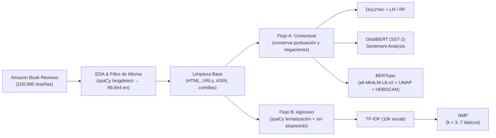
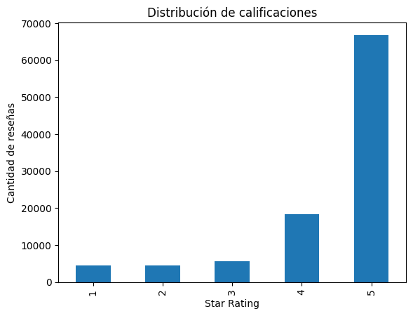
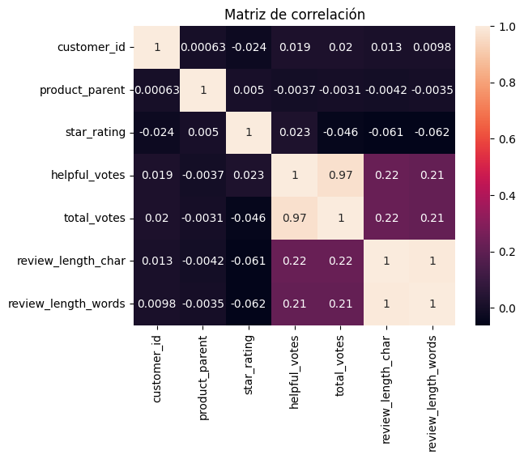
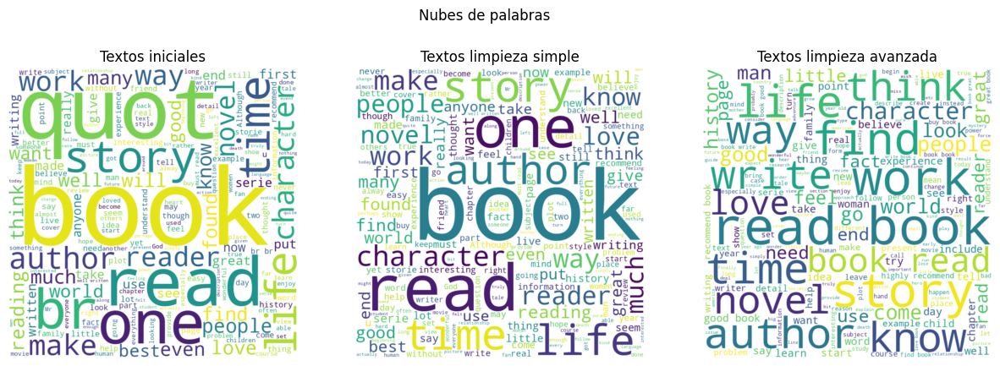
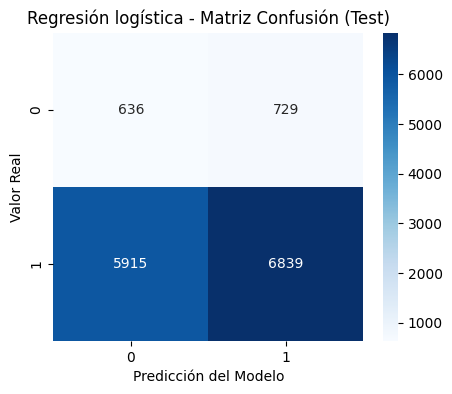
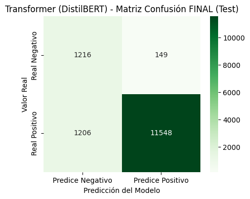
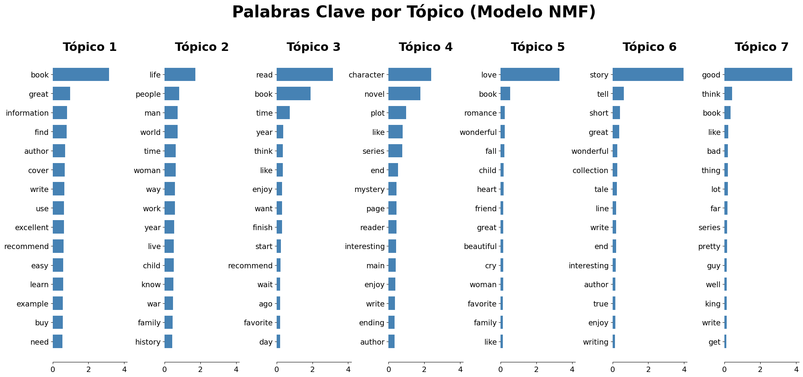

# 📚 NLP Book Reviews Analysis


[](https://colab.research.google.com/github/Andresfel1pe410/nlp-book-reviews-analysis/blob/main/notebooks/book_reviews_nlp_pipeline.ipynb)


Análisis de reseñas de libros del **Amazon US Customer Reviews Dataset** (100,000 reseñas) mediante un **pipeline dual de Procesamiento de Lenguaje Natural (NLP)** que combina **Análisis de Sentimientos supervisado** (ML clásico vs. Transformers) y **Modelado de Tópicos no supervisado** (NMF vs. BERTopic).

> Proyecto desarrollado en el marco del curso **Procesamiento y Entendimiento de Lenguaje Natural** (64 horas) de la **Universidad Nacional de Colombia** — Facultad de Ingeniería, Departamento de Ingeniería de Sistemas e Industrial.
> 📄 [Ver certificación del curso](docs/Procesamiento_y_entendimiento_de_lenguaje_natural.pdf)

---

## 🎯 Problema de Negocio

En el sector editorial y el comercio electrónico de libros, las calificaciones numéricas (1 a 5 estrellas) no explican **por qué** un lector quedó satisfecho o decepcionado. Este proyecto transforma texto no estructurado de reseñas en inteligencia accionable para editoriales, librerías digitales y autores:

- **Detección automática de polaridad y quejas** en un escenario altamente desbalanceado (~90% reseñas positivas vs. ~10% negativas).
- **Descubrimiento no supervisado de temas y micro-géneros** (narrativa, romance, historia, hábitos de lectura, no-ficción, etc.) sin depender de etiquetas manuales.

---

## 🏗️ Arquitectura del Pipeline Dual

El corpus se filtra al idioma inglés (99,844 reseñas), se limpia de ruido digital (HTML, URLs, etiquetas ASIN) y se **bifurca en dos flujos de preprocesamiento** adaptados a cada familia de modelos:



---

## 📊 Análisis Exploratorio y Preprocesamiento

El EDA evidenció un fuerte desbalanceo en las calificaciones (`66.8%` de 5 estrellas y `18.4%` de 4 estrellas, frente a solo `9.1%` negativas de 1–2 estrellas) y una correlación prácticamente nula entre las variables estructurales (longitud del texto, votos) y el `star_rating`, confirmando que la señal predictiva reside en la semántica del texto.

<p align="center">
  
  
</p>

Comparativa visual del efecto de los dos niveles de limpieza (texto original, limpieza contextual simple y limpieza avanzada lematizada):

<p align="center">
  
</p>

---

## 🏆 Resultados

### 1. Análisis de Sentimientos (Clasificación Binaria)

Partición estratificada **70% Train / 15% Validation / 15% Test** (excluyendo reseñas neutrales de 3 estrellas) para evitar fuga de datos (*data leakage*).

| Modelo | Representación | Split | Accuracy | F1-Macro | Precision (Neg) | Recall (Neg) | F1 (Neg) |
| --- | --- | :---: | :---: | :---: | :---: | :---: | :---: |
| Logistic Regression (`balanced`) | Doc2Vec | Test | 52.94% | 0.4169 | 0.10 | 0.47 | 0.16 |
| Random Forest (`balanced`) | Doc2Vec | Val | 78.38% | 0.4946 | 0.09 | 0.14 | 0.11 |
| **DistilBERT (`sst-2-english`)** | **Transformer Contextual** | **Test** | **90.40%** | **0.7934** | **0.50** | **0.89** | **0.64** |

> **Conclusión clave:** **DistilBERT** superó ampliamente a los baselines clásicos, logrando un **89% de Recall en la clase minoritaria (reseñas negativas)** y un **90.4% de Accuracy global** sin requerir balanceo artificial de clases, demostrando la ventaja de la atención bidireccional para capturar negaciones, matices y sarcasmo.

<p align="center">
  
  
</p>

---

### 2. Modelado de Tópicos (No Supervisado)

- **NMF sobre TF-IDF:** Al evaluar configuraciones entre `k=3` y `k=7`, **7 componentes** ofrecieron la mejor separación semántica:
  1. **No-Ficción y Educación** (*information, learn, example, use*)
  2. **Biografías e Historia** (*life, people, man, world, history*)
  3. **Hábitos de Lectura** (*read, time, year, finish, wait*)
  4. **Ficción y Estructura Narrativa** (*character, novel, plot, mystery, ending*)
  5. **Novela Romántica** (*love, romance, wonderful, heart, cry*)
  6. **Antologías y Cuentos Cortos** (*story, short, collection, tale*)
  7. **Reseñas Críticas** (*good, think, bad, pretty, well*)

<p align="center">
  
</p>

- **BERTopic (`all-MiniLM-L6-v2` + UMAP + HDBSCAN + c-TF-IDF):** Descubrió automáticamente clústeres temáticos de alta coherencia (religión, música, política, negocios, cocina, entre otros) aislando las reseñas genéricas en el tópico de ruido (`-1`).

---

## 📁 Estructura del Repositorio

```text
nlp-book-reviews-analysis/
├── README.md
├── requirements.txt
├── .gitignore
├── LICENSE
├── assets/                                  # Visualizaciones exportadas del notebook
│   ├── rating_distribution.png
│   ├── correlation_matrix.png
│   ├── wordclouds_comparison.png
│   ├── confusion_matrix_lr_test.png
│   ├── confusion_matrix_rf_val.png
│   ├── confusion_matrix_distilbert_test.png
│   └── nmf_topics_k7.png
├── docs/
│   └── Procesamiento_y_entendimiento_de_lenguaje_natural.pdf
└── notebooks/
    └── book_reviews_nlp_pipeline.ipynb      # Notebook completo del proyecto
```

---

## ⚙️ Cómo Reproducir el Proyecto

### 1. Clonar el repositorio e instalar dependencias

```bash
git clone https://github.com/Andresfel1pe410/nlp-book-reviews-analysis.git
cd nlp-book-reviews-analysis
pip install -r requirements.txt
python -m spacy download en_core_web_sm
```

### 2. Obtener el dataset

Por tamaño, los archivos de datos (`.tsv`/`.csv`) no se incluyen en el repositorio.

1. Descarga el subconjunto de libros del **Amazon US Customer Reviews Dataset** desde [Kaggle](https://www.kaggle.com/datasets/cynthiarempel/amazon-us-customer-reviews-dataset).
2. Toma una muestra de 100,000 registros y guárdala como `amazon_reviews_last_100k.tsv` en el directorio de ejecución del notebook.

### 3. Ejecutar el notebook

Abre [`notebooks/book_reviews_nlp_pipeline.ipynb`](notebooks/book_reviews_nlp_pipeline.ipynb) en **Google Colab** (recomendado con GPU T4/A100 para DistilBERT y BERTopic) o en **Jupyter Lab**.

---

## 🚀 Trabajo Futuro

- Incorporar *stopwords* de dominio literario (`book`, `read`, `author`) en la vectorización TF-IDF para incrementar la pureza de los tópicos NMF.
- Evaluar un baseline adicional con **TF-IDF + Regresión Logística / LinearSVC** y ajustar el entrenamiento de **Doc2Vec** (`workers > 0`).
- Realizar *fine-tuning* de DistilBERT/RoBERTa específicamente sobre reseñas de libros incluyendo la clase neutral (3 clases).

---

## 👥 Autores

- **Andres Felipe Nieto Gutierrez**
- **Sebastian Rodriguez Ardila**
- **David Alexander Núñez Quintero**

---

## 📄 Licencia

Este proyecto se distribuye bajo la licencia [MIT](LICENSE).
